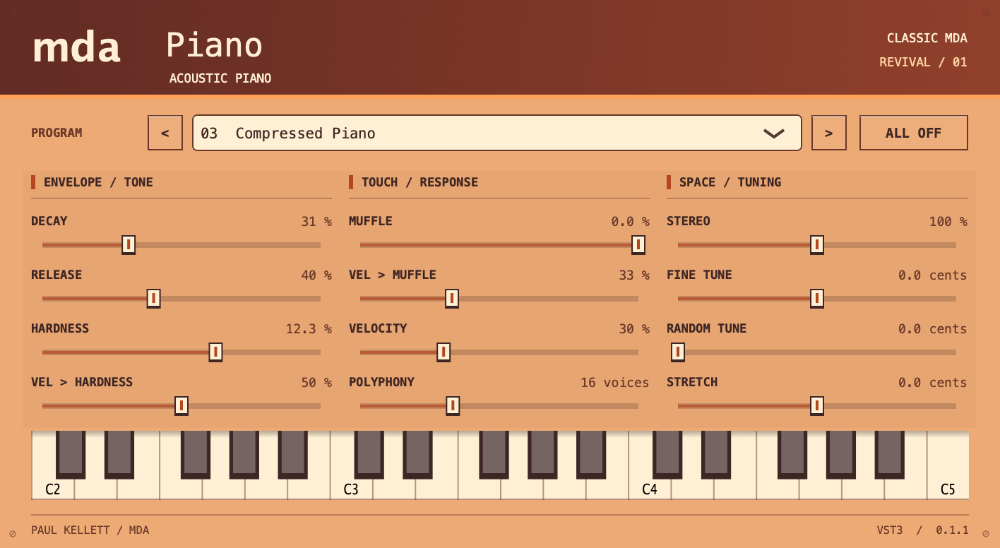

# MDA VST3 — MDA Revival

Five classic MDA plugins rebuilt as native **Apple Silicon VST3s**, with compact vintage interfaces in **sunset orange**.

[**Download v0.1.1 for macOS / Apple Silicon**](https://github.com/vincepeaceuk/mda-vst3/releases/download/v0.1.1/MDA-Revival-0.1.1-macOS-arm64.zip) · [Release notes and checksums](https://github.com/vincepeaceuk/mda-vst3/releases/tag/v0.1.1)

This is an independent open-source revival of Paul Kellett's MDA plugins. The current download is a **preview release**, supplied with the installer, all five VST3 bundles, interface previews, licence notices and complete corresponding source, including the pinned JUCE framework.



## Included plugins

| Plugin | Type | Factory programs | Find it in Cubase |
| --- | --- | --- | --- |
| **mda Piano** | Acoustic piano instrument | 8 | Instruments → Sampler |
| **mda ePiano** | Electric piano instrument | 8, including three original duplicate slots | Instruments → Sampler |
| **mda DX10** | FM synthesizer | 32 | Instruments → Synth |
| **mda JX10** | Analogue-style synthesizer | 52 | Instruments → Synth |
| **mda Leslie** | Rotary speaker audio effect | 3 | Inserts → Modulation |

The four instruments receive MIDI. Leslie processes audio as an insert effect. Search for **mda** in the plugin selector; the vendor is **MDA Revival**.

[View ePiano](https://github.com/vincepeaceuk/mda-vst3/blob/v0.1.1/docs/screenshots/EPiano.png) · [View DX10](https://github.com/vincepeaceuk/mda-vst3/blob/v0.1.1/docs/screenshots/DX10.png) · [View JX10](https://github.com/vincepeaceuk/mda-vst3/blob/v0.1.1/docs/screenshots/JX10.png) · [View Leslie](https://github.com/vincepeaceuk/mda-vst3/blob/v0.1.1/docs/screenshots/Leslie.png)

## What has been done

- Built five separate VST3 plugins for native Apple Silicon hosts.
- Integrated the Piano, ePiano, DX10 and JX10 JUCE conversions by Matthijs Hollemans, retaining their audio algorithms and factory-program tables.
- Ported Leslie from the original MIT-licensed MDA rotary implementation, with safe delay allocation and wraparound at high sample rates.
- Replaced the generic editors with compact custom panels, grouped faders, readable values and the shared sunset-orange palette.
- Added factory-program menus and previous/next buttons. Instruments also have an audition keyboard and an **ALL OFF** button to clear voices and sustain.
- Fixed selected-program recall alongside edited parameter values, and guarded invalid program indices and malformed state data.
- Kept parameters available to host automation, and added reproducible builds, validation tools, screenshots and an installer that backs up existing copies.

Version **0.1.1** is the sunset-orange refresh. It retains the VST3 identities and parameter-state format from 0.1.0.

## Requirements

- **Apple Silicon Mac**: M1 or later; the downloadable binaries are **arm64**.
- A VST3 host running natively on Apple Silicon. The original manual host checks used **Cubase 16.0.5.174**.
- The build targets **macOS 11 or later**. Executed validation used **macOS 26.6.2**; older macOS versions have not been validated.

The release does not contain Intel/x86_64 binaries. A host running under Rosetta needs an Intel or universal build; that configuration has not been validated here. These downloads are VST3 plugins, with no AU or AAX build included.

## Installation

### Using the installer

1. Open the [v0.1.1 release](https://github.com/vincepeaceuk/mda-vst3/releases/tag/v0.1.1) and download **MDA-Revival-0.1.1-macOS-arm64.zip** from **Assets**. The GitHub “Source code” archives do not contain the compiled plugins.
2. Extract the ZIP. Open the **MDA Revival 0.1.1** folder.
3. Quit Cubase and any other host that is using these plugins.
4. Open **Install.command**. It installs the five bundles for your user account in:

   ```text
   ~/Library/Audio/Plug-Ins/VST3/
   ```

   Existing copies are moved into a dated folder under:

   ```text
   ~/Library/Audio/Plug-Ins/MDA Revival Backups/
   ```

5. Start Cubase again and search for **mda** when adding an instrument track or insert effect.

The installer uses your user plugin folder and does not require an administrator password.

### Manual installation

1. In Finder, choose **Go → Go to Folder…** and enter `~/Library/Audio/Plug-Ins/VST3/`. Create the **VST3** folder if it does not exist.
2. Copy the five **.vst3 bundles** from the extracted archive's **VST3** folder into that location. Copy each whole bundle.
3. Restart your VST3 host and rescan its plugins if needed. Back up existing copies before replacing them manually.

### If Cubase does not list them

In **Cubase 16**, open **Settings → Plug-ins** and click the rescan button at the bottom of the plugin list. An explicit rescan was needed and succeeded during the original installation. Use the plugin categories shown in the table above.

### macOS security prompts

These preview binaries are **ad hoc signed and are not Developer ID signed or notarised**. macOS can show a security prompt or prevent downloaded software from loading. Refer to [Apple's guidance on opening downloaded apps and plugins](https://support.apple.com/en-gb/102445), or use the source-build steps below.

### Uninstalling

Quit your host, then move the five installed MDA bundles out of `~/Library/Audio/Plug-Ins/VST3/`. The installer backups are kept separately in **MDA Revival Backups**.

## Using the controls

- Choose a factory program from the menu or with **< / >**.
- Drag a fader to adjust its parameter. Double-click it to restore the parameter's default value.
- Use the keyboard at the bottom of an instrument editor to audition notes.
- **ALL OFF** clears the instrument's active voices and sustain.
- Save your host project to retain the selected program and edited settings.

## Compatibility with the old plugins

These plugins have **new VST3 identities**. They do **not** automatically replace legacy VST2 instances in existing projects, and there is no FXP/FXB-bank import yet. Replace old instances manually and recreate any custom settings you need.

The instrument algorithms and factory tables come from the pinned JUCE conversions. Exact sample-for-sample equivalence to the original 2015 Intel VST2 binaries has not been established. Leslie's three speed programs are new convenience presets based on the original rotary settings.

## Build from source

Prerequisites: **Git, Python 3, CMake 3.22+, Ninja, and Apple's command-line build tools**. The project uses C++20.

```sh
git clone https://github.com/vincepeaceuk/mda-vst3.git
cd mda-vst3
python3 tools/bootstrap.py
cmake -S . -B build -G Ninja -DCMAKE_BUILD_TYPE=Release -DCMAKE_OSX_ARCHITECTURES=arm64
cmake --build build -j 4
ctest --test-dir build --output-on-failure
```

`bootstrap.py` fetches **JUCE 9.0.5** at the exact pinned commit and verifies an existing checkout. The complete-source folder in the downloadable plugin ZIP already includes JUCE.

The VST3 bundles are written beneath `build/MDA_<model>_artefacts/Release/VST3/`. The default build does not install them. Copy the built bundles to your user VST3 folder, or package them from a Git checkout with:

```sh
python3 tools/package.py
```

The packager creates the plugin ZIP and a SHA-256 checksum in `dist/`, including complete corresponding source. The bundled JUCE source remains out of the Git repository and is supplied in the release ZIP.

An optional universal build can be requested in a separate directory using `'-DCMAKE_OSX_ARCHITECTURES=arm64;x86_64'`. Test both architectures before distributing that build; it is not the validated release configuration.

## Validation and current limits

The 0.1.1 build passed **all 11 CTest targets**, including direct processor and VST3-host checks; those 11 tests were rerun successfully on 24 November 2026 before publication. Audio tests cover **164 rendering cases**, all **103 factory-program slots**, 44.1/48/96/192 kHz, and 32/256/1024-sample blocks. The sunset-orange refresh produced identical energy and peak measurements to the prior build in those cases.

The original port also passed **pluginval strictness level 5 for all five plugins**. Cubase 16 discovered all five, and the original manual checks opened Piano, ePiano and Leslie inside Cubase. See [the initial verification report](https://github.com/vincepeaceuk/mda-vst3/blob/v0.1.1/docs/VERIFICATION.md) and [the sunset-orange update](https://github.com/vincepeaceuk/mda-vst3/blob/v0.1.1/docs/SUNSET-ORANGE.md) for exact evidence and the distinction between automated and manual checks.

Extended musical-session testing, recorded automation, hardware MIDI, Cubase save/reopen, older macOS releases, Intel/Rosetta, Developer ID notarisation and public-download testing on another Mac remain follow-up checks. AddressSanitizer could not initialise on the original test machine; the executed Leslie safety checks used UBSan and high-rate stress tests. Test results describe the exercised cases, not a guarantee for every host or performance.

## Credits and licensing

- **Paul Kellett** — original MDA algorithms and instruments.
- **Matthijs Hollemans / M.I. Hollemans** — [JUCE instrument conversions](https://github.com/hollance/mda-plugins-juce), based on commit `552702479a9eac534f3abbf6e878a5eab473e0cb`.
- **Arne Scheffler / Steinberg's MDA VST3 example** — [Leslie VST3 adaptation](https://github.com/steinbergmedia/vst3_public_sdk/blob/master/samples/vst/mda-vst3/source/mdaLeslieProcessor.cpp).
- **JUCE** — framework version **9.0.5**, pinned to `d60b7a78030661574a615b586d9325ba7a7fa7dd`.

The combined JUCE-linked builds and new integration/editor code are supplied under **AGPL-3.0-or-later**. The original MDA and Hollemans source retains its **MIT** notices. See [LICENSE.md](https://github.com/vincepeaceuk/mda-vst3/blob/v0.1.1/LICENSE.md) and [licenses/](https://github.com/vincepeaceuk/mda-vst3/tree/v0.1.1/licenses) for the full notices and framework dependency inventory. Complete corresponding source is included with the plugin ZIP.

This is an independent revival and is not an official MDA, Steinberg or JUCE release.
